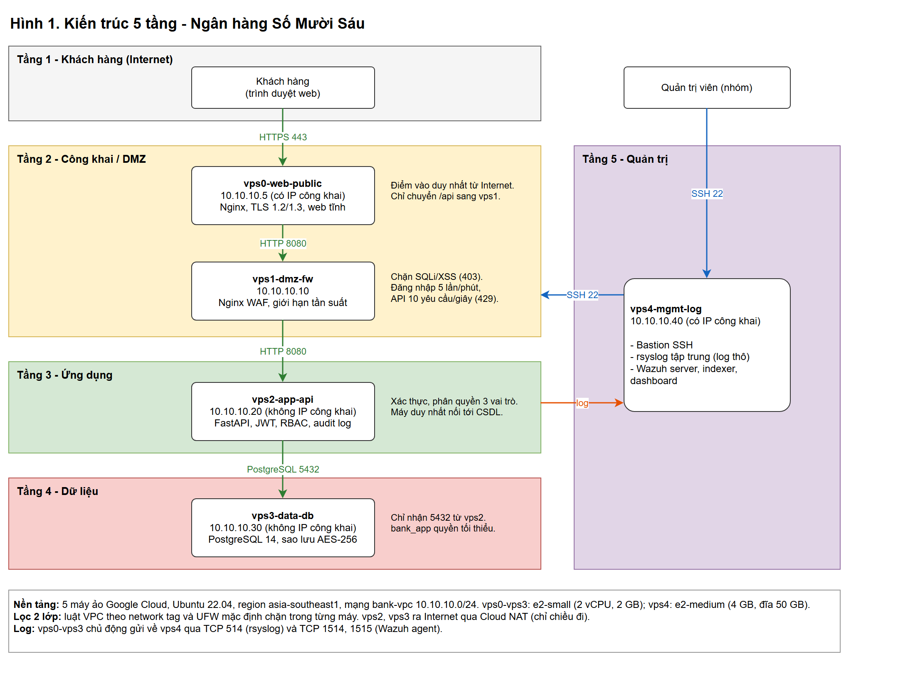

# Đề 16: Thiết kế hạ tầng CNTT an toàn cho ngân hàng số

Học phần Nhập môn Công nghệ nền tảng (RIPT1304), Nhóm 1B.

**Ngân hàng Số Mười Sáu** là mô hình ngân hàng số giả định. Nhóm dựng 5 máy ảo Ubuntu trên Google Cloud, tách thành 5 vùng có kiểm soát: khách hàng, công khai, ứng dụng, dữ liệu và quản trị. Hệ thống chỉ dùng dữ liệu giả lập, không xử lý giao dịch tài chính thật. Báo cáo chính, video và phiếu đóng góp cá nhân nộp riêng.

## 1. Thành viên và phân công

| Họ tên | MSSV | Vai trò | Phụ trách |
|---|---|---|---|
| Đỗ Quốc Khánh | B24DCCC157 | SV1 | Kiến trúc và phân tích nguy cơ, hạ tầng GCP, Wazuh SIEM giám sát 5 máy, so sánh Wazuh với rsyslog (mở rộng tự chọn), tích hợp |
| Vũ Trọng Hiếu | B24DCCC122 | SV2 | Phân vùng và lọc truy cập: UFW, luật VPC, Nginx trên vps0 và vps1 |
| Trần Đức Thắng | B24DCCC246 | SV3 | Xác thực, dữ liệu, sao lưu: backend vps2, PostgreSQL vps3, sao lưu mã hóa và phục hồi |
| Đào Anh Đức | B24DCCC066 | SV4 | Kiểm thử chính sách và nhật ký: audit log ba tầng, luồng log thô rsyslog, KT1–KT3 |

## 2. Kiến trúc hệ thống



```text
Khách hàng ──443──► vps0-web-public   10.10.10.5   Nginx, TLS, giao diện web
                        │ 8080
                        ▼
                    vps1-dmz-fw       10.10.10.10  Nginx WAF, giới hạn tần suất
                        │ 8080
                        ▼
                    vps2-app-api      10.10.10.20  FastAPI, JWT, RBAC, audit log
                        │ 5432
                        ▼
                    vps3-data-db      10.10.10.30  PostgreSQL, sao lưu mã hóa

Quản trị ──SSH──► vps4-mgmt-log       10.10.10.40  Bastion, rsyslog tập trung,
                                                   Wazuh server + indexer + dashboard
```

Mỗi chặng chỉ mở đúng một cổng cho đúng một máy nguồn. Mặc định chặn mọi kết nối đến, lọc ở hai lớp: luật VPC của Google Cloud chặn từ Internet, UFW trong từng máy quyết định máy nào trong subnet được vào cổng nào (chi tiết ở [`bang-quy-hoach.md`](tai-lieu-ky-thuat/thiet-ke/bang-quy-hoach.md)). vps0–vps3 cài Wazuh agent, gửi sự kiện về vps4.

## 3. Tài liệu thiết kế

Toàn bộ nằm trong [`tai-lieu-ky-thuat/thiet-ke/`](tai-lieu-ky-thuat/thiet-ke/).

| File | Nội dung |
|---|---|
| [`01-kien-truc-5-tang.png`](tai-lieu-ky-thuat/thiet-ke/01-kien-truc-5-tang.png) | Kiến trúc 5 tầng, luồng truy cập từ khách hàng tới dữ liệu |
| [`02-phan-vung-loc-truy-cap.png`](tai-lieu-ky-thuat/thiet-ke/02-phan-vung-loc-truy-cap.png) | Phân vùng và lọc truy cập: mặc định chặn, chỉ mở luồng cần thiết (FW-01 đến FW-12; FW-13 trong bảng quy hoạch) |
| [`03-nguy-co-bien-phap.png`](tai-lieu-ky-thuat/thiet-ke/03-nguy-co-bien-phap.png) | Năm nguy cơ NC1–NC5, biện pháp và bài kiểm thử tương ứng |
| [`04-nhat-ky-giam-sat.png`](tai-lieu-ky-thuat/thiet-ke/04-nhat-ky-giam-sat.png) | Nhật ký và giám sát: hai luồng độc lập về vps4 (rsyslog log thô, Wazuh SIEM) |
| [`bang-quy-hoach.md`](tai-lieu-ky-thuat/thiet-ke/bang-quy-hoach.md) | Tài nguyên và IP từng máy, cổng lắng nghe, luật VPC, luật lọc FW-01 đến FW-13, ma trận phân quyền API và CSDL |
| [`so-sanh-wazuh-rsyslog.md`](tai-lieu-ky-thuat/thiet-ke/so-sanh-wazuh-rsyslog.md) | Mở rộng tự chọn: so sánh Wazuh với rsyslog bằng cùng tiêu chí và số đo |
| [`da-demo-va-de-xuat.md`](tai-lieu-ky-thuat/thiet-ke/da-demo-va-de-xuat.md) | Phân biệt biện pháp đã demo (có ảnh bằng chứng) với biện pháp chỉ đề xuất |

## 4. Môi trường và phiên bản phần mềm

| Thành phần | Giá trị |
|---|---|
| Nền tảng | Google Cloud, region `asia-southeast1`, zone `asia-southeast1-b` |
| Mạng | VPC `bank-vpc`, subnet `10.10.10.0/24`, Cloud NAT cho vps2 và vps3 |
| Máy ảo | `e2-small` (vps0–vps3), `e2-medium` (vps4) |

Phiên bản đọc trực tiếp trên các máy đang chạy:

| Phần mềm | Phiên bản | Máy |
|---|---|---|
| Hệ điều hành | Ubuntu 22.04.5 LTS | cả 5 máy |
| Nginx | 1.18.0 | vps0, vps1 |
| Certbot (Let's Encrypt, tên miền `muoisaubank16.duckdns.org`) | 1.21.0 | vps0 |
| Python | 3.10.12 | vps2 |
| FastAPI, Uvicorn, Pydantic | 0.110.0, 0.28.0, 2.6.4 | vps2 |
| psycopg2-binary, PyJWT, bcrypt | 2.9.9, 2.8.0, 4.0.1 | vps2 |
| PostgreSQL | 14.24 | vps3 |
| OpenSSL (mã hóa sao lưu AES-256) | 3.0.2 | vps3 |
| rsyslog | 8.2112.0 | vps2, vps4 |
| Wazuh manager, indexer, dashboard | 4.14.10 | vps4 |
| Wazuh agent | 4.14.10 | vps0–vps3 |
| UFW | 0.36.1 | cả 5 máy |
| jq (đọc alert Wazuh trong script kiểm thử) | 1.6 | vps4 |

## 5. Cấu trúc thư mục

```text
README.md
kiem-thu/
  BANG-KIEM-THU-SV1.md … SV4.md      bảng kiểm thử 6 cột của từng thành viên
  DOI-SOAT-3-NGUON.md                đối soát số sự kiện ở kho log vps4, audit_logs vps3, alert Wazuh
  bang-chung/                        ảnh chụp terminal và dashboard có timestamp
    ha-tang/  KT1/  KT2/  KT3/  SIEM/  SV3/
tai-lieu-ky-thuat/
  thiet-ke/                          sơ đồ, bảng quy hoạch, so sánh, đã demo và đề xuất
  ma-nguon/
    backend/                         main.py (FastAPI), requirements.txt
    database/                        init_db.sql (bảng, dữ liệu mẫu, tài khoản bank_app, GRANT)
    frontend/                        giao diện khách hàng và trang /admin
  cau-hinh/
    vps0-web-public/                 muoisau.conf (Nginx, TLS, auth_request /admin)
    vps1-dmz-fw/                     muoisau-waf.conf (WAF, giới hạn tần suất)
    vps2-app-api/                    bank-app.service, bank-app.env.example, rsyslog chuyển log, logrotate
    vps3-data-db/                    pg_hba.conf, postgresql-custom.conf, backup_bank_db.sh, cron
    vps4-mgmt-log/                   rsyslog tập trung, logrotate, wazuh/ (decoder, rule, agent.conf theo nhóm)
    <máy>/ufw-<máy>_<giờ>.png        ảnh ufw status verbose của từng máy
  scripts/
    cai-dat/                         setup-vps2.sh, setup-vps3.sh
    kiem-thu/                        script kiểm thử của SV1–SV4
```

## 6. Dựng lại hệ thống từ đầu

Thứ tự: hạ tầng GCP, vps4 (nơi nhận log và Wazuh manager), vps3, vps2, vps1, vps0, rồi cài agent cho vps0–vps3. Các bước trên máy ảo đều bắt đầu bằng việc clone repo này về máy đó (vps2 và vps3 ra Internet qua Cloud NAT):

```bash
git clone https://github.com/Kmisiz/Nhom1B-De16.git && cd Nhom1B-De16
```

### 6.1. Hạ tầng Google Cloud (Cloud Shell)

```bash
gcloud compute networks create bank-vpc --subnet-mode=custom
gcloud compute networks subnets create bank-subnet --network=bank-vpc --region=asia-southeast1 --range=10.10.10.0/24
gcloud compute routers create bank-router --network=bank-vpc --region=asia-southeast1
gcloud compute routers nats create bank-nat --router=bank-router --region=asia-southeast1 --auto-allocate-nat-external-ips --nat-all-subnet-ip-ranges

gcloud compute firewall-rules create bank-fw-allow-web-vps0 --network=bank-vpc --direction=INGRESS --action=ALLOW --rules=tcp:80,tcp:443 --source-ranges=0.0.0.0/0 --target-tags=web-public
gcloud compute firewall-rules create bank-fw-ssh-bastion --network=bank-vpc --direction=INGRESS --action=ALLOW --rules=tcp:22 --source-ranges=0.0.0.0/0 --target-tags=bastion
gcloud compute firewall-rules create bank-fw-internal-subnet --network=bank-vpc --direction=INGRESS --action=ALLOW --rules=tcp:22,tcp:8080,tcp:5432,tcp:514,udp:514,icmp --source-ranges=10.10.10.0/24
gcloud compute firewall-rules create allow-wazuh-siem-internal --network=bank-vpc --direction=INGRESS --action=ALLOW --rules=tcp:1514,tcp:1515,tcp:514,udp:514 --source-ranges=10.10.10.0/24
```

```bash
IMG="--image-family=ubuntu-2204-lts --image-project=ubuntu-os-cloud --zone=asia-southeast1-b --subnet=bank-subnet"
gcloud compute instances create vps0-web-public $IMG --machine-type=e2-small  --boot-disk-size=20GB --private-network-ip=10.10.10.5  --tags=web-public
gcloud compute instances create vps1-dmz-fw     $IMG --machine-type=e2-small  --boot-disk-size=20GB --private-network-ip=10.10.10.10
gcloud compute instances create vps2-app-api    $IMG --machine-type=e2-small  --boot-disk-size=20GB --private-network-ip=10.10.10.20 --no-address
gcloud compute instances create vps3-data-db    $IMG --machine-type=e2-small  --boot-disk-size=20GB --private-network-ip=10.10.10.30 --no-address
gcloud compute instances create vps4-mgmt-log   $IMG --machine-type=e2-medium --boot-disk-size=50GB --private-network-ip=10.10.10.40 --tags=bastion
```

Tài khoản SSH của từng thành viên được thêm bằng khóa công khai trong mục Metadata, SSH Keys của project (tài khoản có sudo trên cả 5 máy). Chỉ vps4 nhận SSH từ Internet; vps0–vps3 vào qua bastion:

```bash
ssh -J <user>@<IP công khai vps4> <user>@10.10.10.20
```

### 6.2. vps4: rsyslog tập trung và Wazuh all-in-one

```bash
C=tai-lieu-ky-thuat/cau-hinh/vps4-mgmt-log
cut -d: -f2- $C/imtcp.txt | sudo tee -a /etc/rsyslog.conf
sudo cp $C/10-central-bank.conf /etc/rsyslog.d/
sudo cp $C/logrotate-central-bank /etc/logrotate.d/central-bank
sudo systemctl restart rsyslog

curl -sO https://packages.wazuh.com/4.14/wazuh-install.sh && sudo bash wazuh-install.sh -a
sudo /var/ossec/bin/agent_groups -a -g web -q
sudo /var/ossec/bin/agent_groups -a -g app -q
sudo install -o wazuh -g wazuh -m 660 $C/wazuh/decoders/bank-app_decoders.xml /var/ossec/etc/decoders/
sudo install -o wazuh -g wazuh -m 660 $C/wazuh/rules/bank-app_rules.xml /var/ossec/etc/rules/
sudo install -o wazuh -g wazuh -m 660 $C/wazuh/groups/web/agent.conf /var/ossec/etc/shared/web/agent.conf
sudo install -o wazuh -g wazuh -m 660 $C/wazuh/groups/app/agent.conf /var/ossec/etc/shared/app/agent.conf
sudo systemctl restart wazuh-manager

sudo ufw default deny incoming && sudo ufw default allow outgoing
sudo ufw allow 22/tcp
sudo ufw allow from 10.10.10.0/24 to any port 514 proto tcp
sudo ufw allow from 10.10.10.0/24 to any port 1514 proto tcp
sudo ufw allow from 10.10.10.0/24 to any port 1515 proto tcp
sudo ufw --force enable
```

Dòng `cut` lấy hai dòng `module(load="imtcp")` và `input(type="imtcp" port="514")` từ `imtcp.txt` để mở cổng TCP 514 nhận log. Lệnh cài Wazuh in mật khẩu `admin` của dashboard ở cuối; dashboard không mở ra Internet, truy cập qua đường hầm SSH:

```bash
ssh -N -L 1612:localhost:443 <user>@<IP công khai vps4>
```

rồi mở `https://localhost:1612` trên máy cá nhân.

### 6.3. vps3: PostgreSQL và sao lưu mã hóa

```bash
sudo bash tai-lieu-ky-thuat/scripts/cai-dat/setup-vps3.sh
```

Script cài PostgreSQL, tạo database `digital_bank` từ `ma-nguon/database/init_db.sql` (bảng, dữ liệu mẫu, tài khoản `bank_app` quyền tối thiểu), chỉ nghe trên `localhost` và `10.10.10.30`, `pg_hba.conf` chỉ nhận `bank_app` từ `10.10.10.20`, bật UFW (SSH từ vps4, 5432 từ vps2), sinh khóa `/root/.backup_passphrase`, tạo `/usr/local/bin/backup_bank_db.sh` và lịch cron 02:00.

### 6.4. vps2: ứng dụng FastAPI và chuyển log

```bash
sudo bash tai-lieu-ky-thuat/scripts/cai-dat/setup-vps2.sh
C=tai-lieu-ky-thuat/cau-hinh/vps2-app-api
sudo cp $C/60-forward-bank-app.conf /etc/rsyslog.d/
sudo cp $C/logrotate-bank-app /etc/logrotate.d/bank-app
sudo systemctl restart rsyslog
```

`setup-vps2.sh` tạo user hệ thống `bankapp`, chép `main.py` vào `/opt/bank-app`, tạo `.env` từ `bank-app.env.example` và sinh `JWT_SECRET` ngẫu nhiên, cài thư viện vào virtualenv, cài service `bank-app` (nghe `10.10.10.20:8080`), bật UFW (SSH từ vps4, 8080 từ vps1). Kiểm tra: `curl http://10.10.10.20:8080/api/health`.

### 6.5. vps1: Nginx WAF

```bash
sudo apt-get install -y nginx
sudo cp tai-lieu-ky-thuat/cau-hinh/vps1-dmz-fw/muoisau-waf.conf /etc/nginx/sites-available/
sudo ln -s /etc/nginx/sites-available/muoisau-waf.conf /etc/nginx/sites-enabled/
sudo rm -f /etc/nginx/sites-enabled/default
sudo nginx -t && sudo systemctl reload nginx

sudo ufw default deny incoming && sudo ufw default allow outgoing
sudo ufw allow from 10.10.10.40 to any port 22 proto tcp
sudo ufw allow from 10.10.10.5 to any port 8080 proto tcp
sudo ufw allow from 10.10.10.40 to any port 8080 proto tcp
sudo ufw --force enable
```

### 6.6. vps0: Nginx, TLS và giao diện

Trỏ bản ghi DuckDNS `muoisaubank16.duckdns.org` về IP công khai của vps0 trước khi xin chứng chỉ.

```bash
sudo apt-get install -y nginx certbot
sudo mkdir -p /var/www/muoisau && sudo cp -r tai-lieu-ky-thuat/ma-nguon/frontend/* /var/www/muoisau/
sudo systemctl stop nginx
sudo certbot certonly --standalone -d muoisaubank16.duckdns.org
sudo cp tai-lieu-ky-thuat/cau-hinh/vps0-web-public/muoisau.conf /etc/nginx/sites-available/
sudo ln -s /etc/nginx/sites-available/muoisau.conf /etc/nginx/sites-enabled/
sudo rm -f /etc/nginx/sites-enabled/default
sudo nginx -t && sudo systemctl start nginx

sudo ufw default deny incoming && sudo ufw default allow outgoing
sudo ufw allow 80/tcp && sudo ufw allow 443/tcp
sudo ufw allow from 10.10.10.40 to any port 22 proto tcp
sudo ufw --force enable
```

### 6.7. Wazuh agent trên vps0–vps3

| Máy | Tên agent | Nhóm |
|---|---|---|
| vps0 | `web-server` | `default,web` |
| vps1 | `waf-server` | `default,web` |
| vps2 | `app-server` | `default,app` |
| vps3 | `db-server` | `default` |

```bash
curl -s https://packages.wazuh.com/key/GPG-KEY-WAZUH | sudo gpg --no-default-keyring --keyring gnupg-ring:/usr/share/keyrings/wazuh.gpg --import && sudo chmod 644 /usr/share/keyrings/wazuh.gpg
echo "deb [signed-by=/usr/share/keyrings/wazuh.gpg] https://packages.wazuh.com/4.x/apt/ stable main" | sudo tee /etc/apt/sources.list.d/wazuh.list
sudo apt-get update
sudo WAZUH_MANAGER="10.10.10.40" WAZUH_AGENT_NAME="web-server" WAZUH_AGENT_GROUP="default,web" apt-get install -y wazuh-agent=4.14.10-1
sudo systemctl daemon-reload && sudo systemctl enable --now wazuh-agent
```

Đổi `WAZUH_AGENT_NAME` và `WAZUH_AGENT_GROUP` theo bảng trên cho từng máy.

### 6.8. Kiểm tra sau khi dựng

| Máy | Lệnh | Kết quả đúng |
|---|---|---|
| vps4 | `sudo /var/ossec/bin/agent_control -l` | 4 agent `Active` |
| Máy cá nhân | `curl -s -o /dev/null -w '%{http_code}\n' https://muoisaubank16.duckdns.org/api/health` | `200` |
| vps4 | `sudo tail -2 /var/log/central-bank/vps2-app-api/bank-app.log` | Có dòng log của ứng dụng chuyển từ vps2 |
| Mọi máy | `sudo ufw status verbose` | Khớp bảng FW-01 đến FW-13 |

## 7. Chạy kiểm thử

Chuẩn bị trên mỗi máy chạy kiểm thử: bật giờ ở dòng nhắc lệnh để ảnh chụp có timestamp, rồi vào thư mục script của bản clone repo.

```bash
echo 'export PS1="[\$(date -Is)] \u@\h:\w\$ "' >> ~/.bashrc && source ~/.bashrc
cd ~/Nhom1B-De16/tai-lieu-ky-thuat/scripts/kiem-thu
```

| Thành viên | Bài | Máy | Lệnh |
|---|---|---|---|
| SV1 | W1: FIM giao diện web | vps0 | `sudo bash w1_fim_test.sh` |
| SV1 | W2: dò mật khẩu SSH | vps4 | `bash w2_ssh_bruteforce_test.sh` |
| SV1 | W3/W3b: đăng nhập API sai qua WAF | vps4 | `bash w3_api_login_test.sh` |
| SV1 | Đếm alert W1–W3b | vps4 | `sudo bash check_wazuh_alerts.sh <giờ UTC bắt đầu, dạng 2026-11-17T16:49:00>` |
| SV1 | Độ trễ rsyslog và Wazuh | vps4 | `sudo bash do_tre_rsyslog_wazuh.sh` |
| SV2 | KT2: vps0 không vào được vps2, vps3 | vps0 | `curl -m 3 http://10.10.10.20:8080/api/health` và `nc -zv -w 3 10.10.10.30 5432` |
| SV2 | KT2.1, KT2.2: vps1 bị chặn, vps2 vào được CSDL | vps1, vps2 | `nc -zv -w 3 10.10.10.30 5432` |
| SV2 | HTTPS, `/admin` ẩn, WAF, đăng nhập sai | Máy cá nhân | lệnh `curl` trong `BANG-KIEM-THU-SV2.md` |
| SV3 | Quyền tối thiểu `bank_app` | vps2 | `bash test-least-privilege-vps2.sh` |
| SV3 | KT1, KT3 qua API | vps2 | `bash test-kt1-kt3-login-vps2.sh` |
| SV3 | 48 yêu cầu API, rồi dọn dữ liệu thử | vps2, vps3 | `bash test-api-vps2.sh`, sau đó trên vps3 `bash check-audit-vps3.sh` |
| SV3 | Chuyển khoản song song | vps2 | `bash test-concurrency-vps2.sh` |
| SV3 | Sao lưu và phục hồi | vps3 | `bash test-backup-restore-vps3.sh` |
| SV3 | Hạ tầng vps2, vps3 | vps2, vps3 | `bash check-infra-vps2.sh`; `bash check-infra-vps3.sh`, `bash check-network-vps3.sh` |
| SV4 | KT1.1, KT1.2 | vps2 | `python3 kt1_test.py`, `python3 kt12_test.py` (nhập user1 và mật khẩu demo) |
| SV4 | KT3.1: đăng nhập sai và log | vps2, vps4 | `python3 kt31_test.py`, rồi trên vps4 `bash check_vps4_logs.sh` |
| SV4 | KT2.2 | vps2 | `bash kt22_test.sh` |
| SV4 | KT3.2: quyền `bank_app` trên `audit_logs` | vps3 | `bash kt32_test.sh` |

Kết quả và ảnh bằng chứng của từng bài:

| Bảng | Nội dung | Ảnh |
|---|---|---|
| [`BANG-KIEM-THU-SV1.md`](kiem-thu/BANG-KIEM-THU-SV1.md) | Hạ tầng GCP, Wazuh SIEM, số đo so sánh | `kiem-thu/bang-chung/ha-tang/`, `kiem-thu/bang-chung/SIEM/` |
| [`BANG-KIEM-THU-SV2.md`](kiem-thu/BANG-KIEM-THU-SV2.md) | KT2, Nginx, WAF, giới hạn tần suất | `kiem-thu/bang-chung/KT2/` |
| [`BANG-KIEM-THU-SV3.md`](kiem-thu/BANG-KIEM-THU-SV3.md) | Xác thực, phân quyền, CSDL, sao lưu và phục hồi | `kiem-thu/bang-chung/SV3/` |
| [`BANG-KIEM-THU-SV4.md`](kiem-thu/BANG-KIEM-THU-SV4.md), [`DOI-SOAT-3-NGUON.md`](kiem-thu/DOI-SOAT-3-NGUON.md) | KT1, KT3, luồng nhật ký ba nguồn | `kiem-thu/bang-chung/KT1/`, `kiem-thu/bang-chung/KT3/` |

## 8. Phạm vi và giả định

- Chỉ dùng dữ liệu giả lập, không kết nối hệ thống ngân hàng thật. Mật khẩu trong `init_db.sql`, `bank-app.env.example` và script kiểm thử là giá trị demo.
- Hệ thống chạy trên máy ảo thật ở Google Cloud, không dùng file mô phỏng Packet Tracer (`.pkt`).
- vps2 và vps3 không có IP công khai, chỉ ra Internet qua Cloud NAT (chiều đi) để cài gói.
- Dashboard Wazuh không mở ra Internet, quản trị viên truy cập qua SSH tunnel vào vps4.
- vps4 chạy Wazuh all-in-one với 4 GB RAM, thấp hơn mức khuyến nghị 8 GB của Wazuh.

## 9. Nguồn tham khảo

- Tài liệu chính thức: Wazuh, Nginx, PostgreSQL, FastAPI, rsyslog, Google Cloud (VPC firewall, Cloud NAT), Let's Encrypt.
- Các thành viên dùng công cụ AI hỗ trợ soạn tài liệu. Phạm vi hỗ trợ và phần tự chỉnh sửa, tự kiểm chứng của từng người khai trong báo cáo cá nhân.
